# Inside the Numbers: All 13 Election-Night Graphics | NCFREE

**Source URL:** https://ncfree.org/2026/11/election-night-2026-the-extended-cut/

Every graphic NCFREE Data Analyst Brendan Higgins built on election night and the morning after, with a short explanation of each.

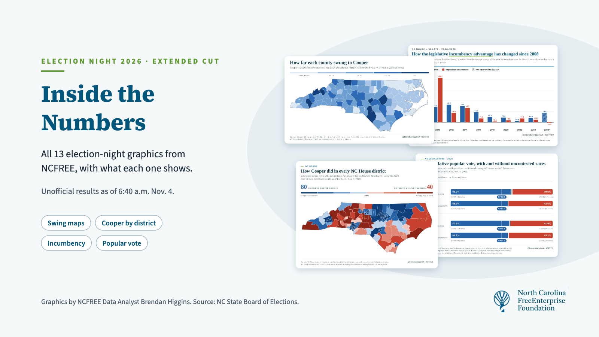

These graphics use unofficial results from the NC State Board of Elections as of 6:40 a.m. on Wednesday, Nov. 4. Results will change as counties add provisional and military and overseas ballots before they certify on Nov. 13. District-level numbers for the U.S. Senate race are NCFREE estimates, because early and mail votes are reported by voting site rather than by home precinct.

## 1. How far each county swung to Cooper

Roy Cooper won the U.S. Senate race by 19.6 points. Donald Trump carried North Carolina by 3.2 points in 2024. That is a 22.8-point swing toward Democrats at the top of the ticket. Every county moved at least 11 points, and the largest swings came in the mountains and in counties south of Raleigh.

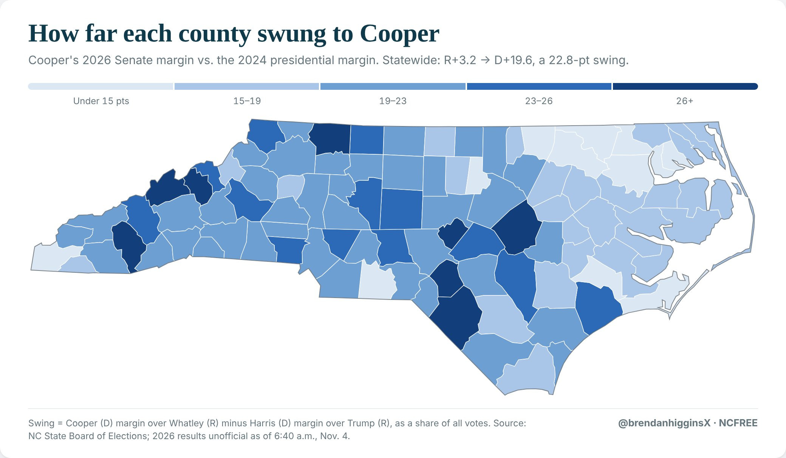

## 2. How Cooper did in every NC House district

Cooper carried an estimated 80 of the 120 NC House districts. If all results hold, House Democrats will hold 71 seats.

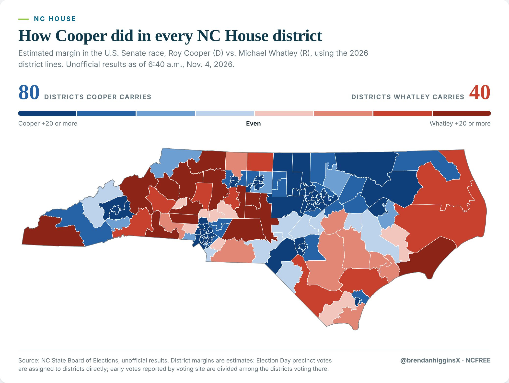

## 3. How Cooper did in every NC Senate district

Cooper carried an estimated 32 of the 50 NC Senate districts. Senate Democrats are on track to hold 24 seats.

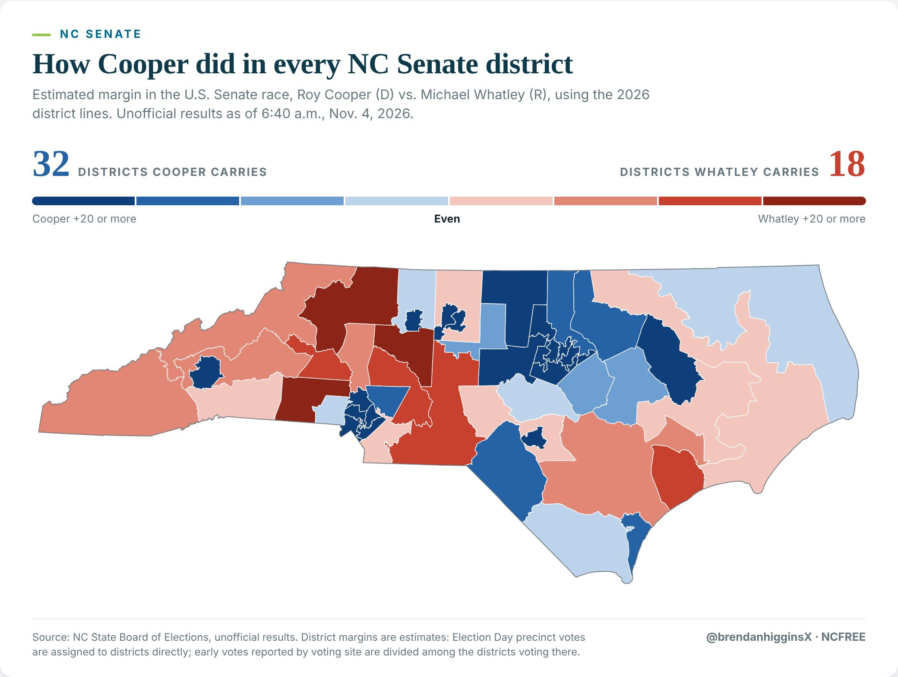

## 4. How far each NC House district swung since 2024

This map compares each district’s 2026 legislative result with its 2024 result on the same lines. Every district with a Democrat and a Republican on the ballot both years moved toward Democrats. The typical district moved 16.3 points.

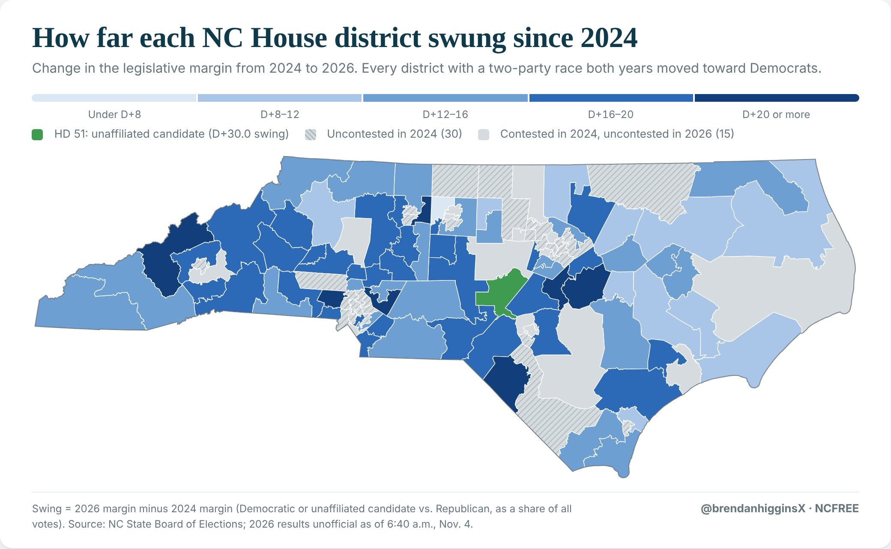

## 5. How far each NC Senate district swung since 2024

The Senate followed the same pattern. The typical Senate district moved 16.1 points toward Democrats.

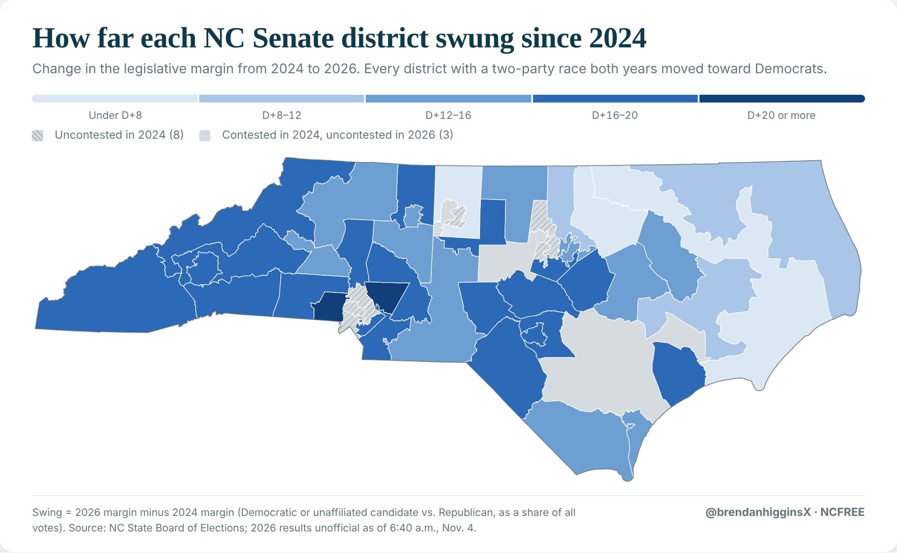

## 6. The biggest and smallest NC House swings

House District 51 moved the most, 30 points, where unaffiliated candidate April Montgomery leads. House District 62 moved the least, 7.4 points, which was still enough for Democrat Shelly Headen to pull ahead.

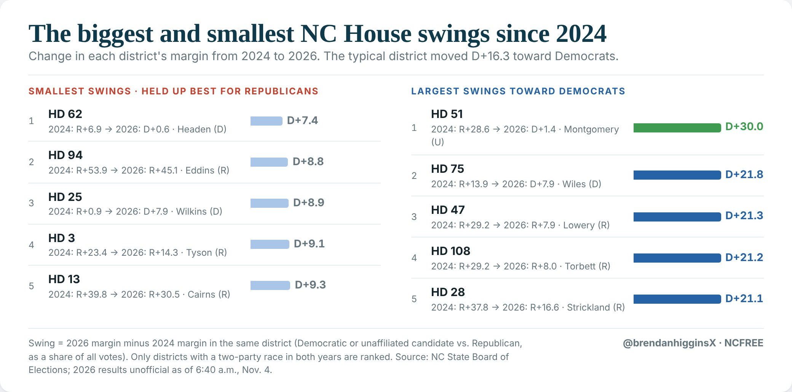

## 7. The biggest and smallest NC Senate swings

Senate District 34 moved the most, 24.1 points, as Democrat April Cook won an open seat. Senate District 26 moved the least, 5.4 points.

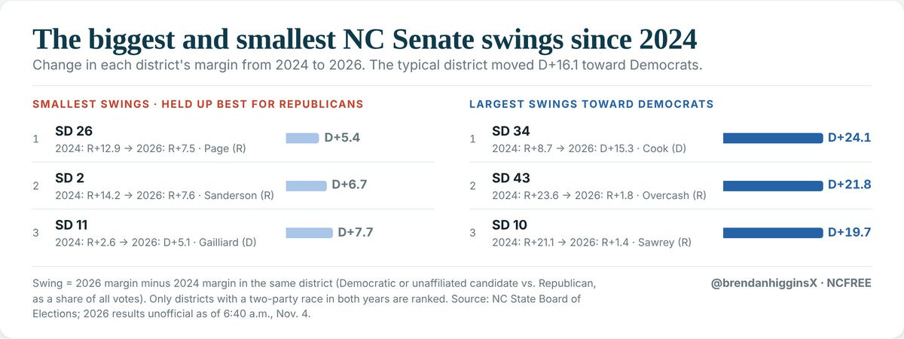

## 8. The biggest NC House overperformers

These candidates did best compared with the U.S. Senate result in their district, measured against the average candidate of their party. Rep. John Blust ran 7.6 points better than the average Republican. April Montgomery is unaffiliated. She appears with the Democrats because she ran against a Republican, though she has said she will not caucus with House Democrats.

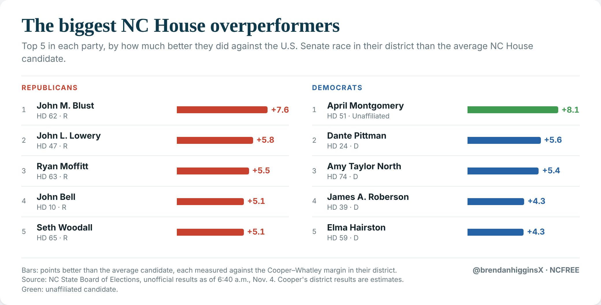

## 9. The biggest NC Senate overperformers

Sen. Danny Britt ran 5.5 points better than the average Republican and leads by 268 votes. His race is not settled. There are 828 provisional ballots outstanding in the district, which covers Robeson, Scotland and Hoke counties. County boards will review each one before they certify results on Nov. 13. Voters who need to fix certain problems, such as a missing photo ID, have until noon on Tuesday, Nov. 10. Britt leads by about 0.5%, so the race could go to a recount if the margin stays within 1% after the canvass. Expect attorneys for both campaigns and both parties to be closely involved at every step. Robeson County was one of two counties, along with Bladen, at the center of the absentee ballot investigation that led the State Board to order a new election in the 9th Congressional District in 2019.

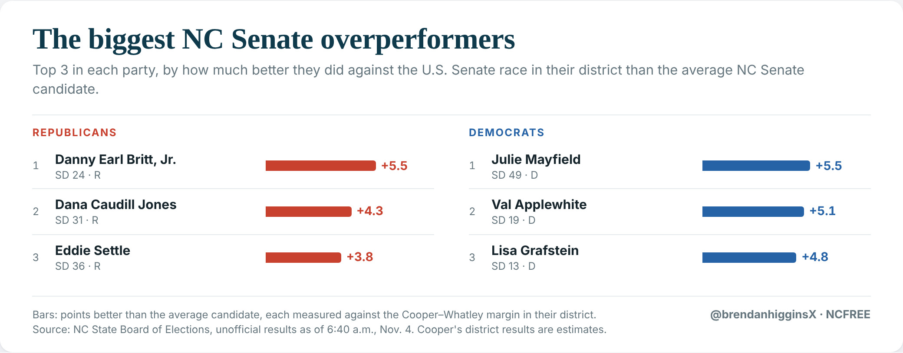

## 10. Cooper outran U.S. House Democrats

Cooper ran ahead of 13 of the 14 Democratic candidates for the U.S. House, by 4.6 points on average. Jamie Ager in the 11th District was the one exception.

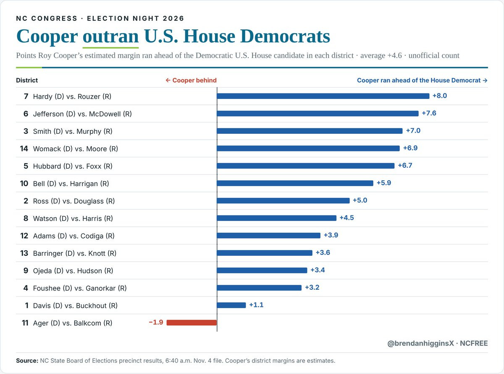

## 11. The legislative popular vote

Democratic candidates won 59.2% of all votes cast for the NC House, but 36 House races did not have both a Democrat and a Republican. With those races replaced by estimates of a two-party race, Democrats won about 56% of the vote in each chamber.

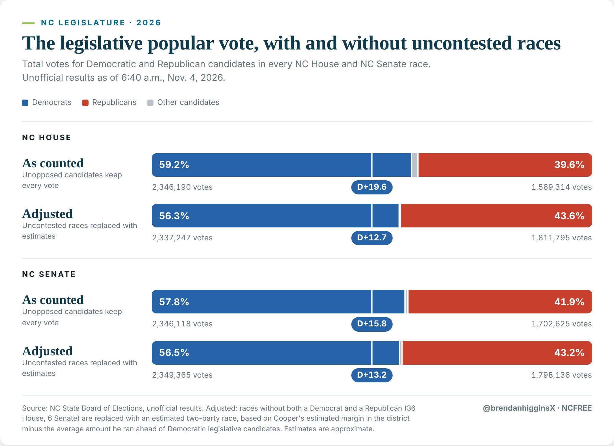

## 12. How the incumbency advantage has changed since 2008

Each bar compares a party’s incumbents with that party’s candidates for open seats, after accounting for how each district voted in statewide races. Republican incumbents had an edge in every election from 2008 through 2024. This year it was −0.2 points.

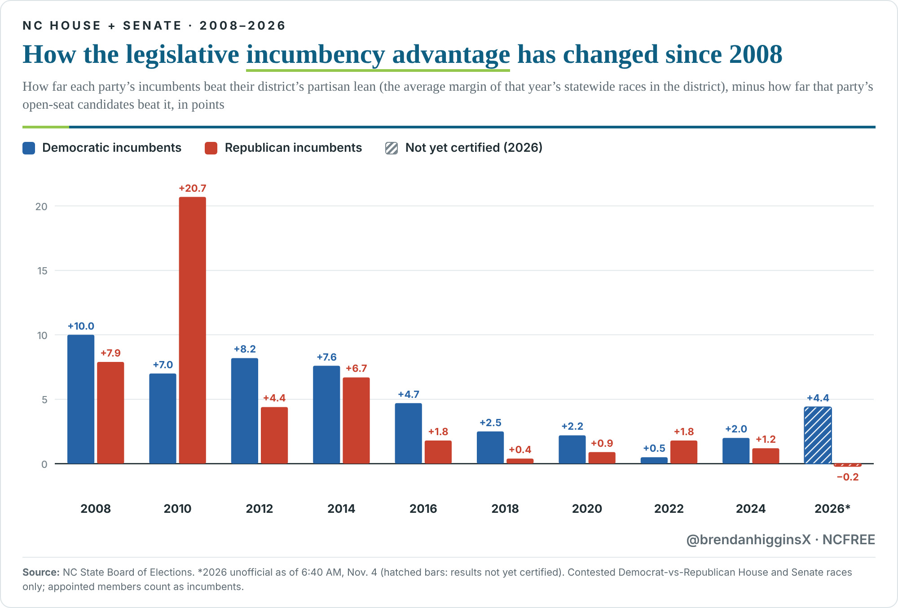

## 13. Which precincts updated their numbers

Of the state’s 2,625 precincts, 98 changed their Election Day totals after they first reported overnight. All 98 were in eight counties.

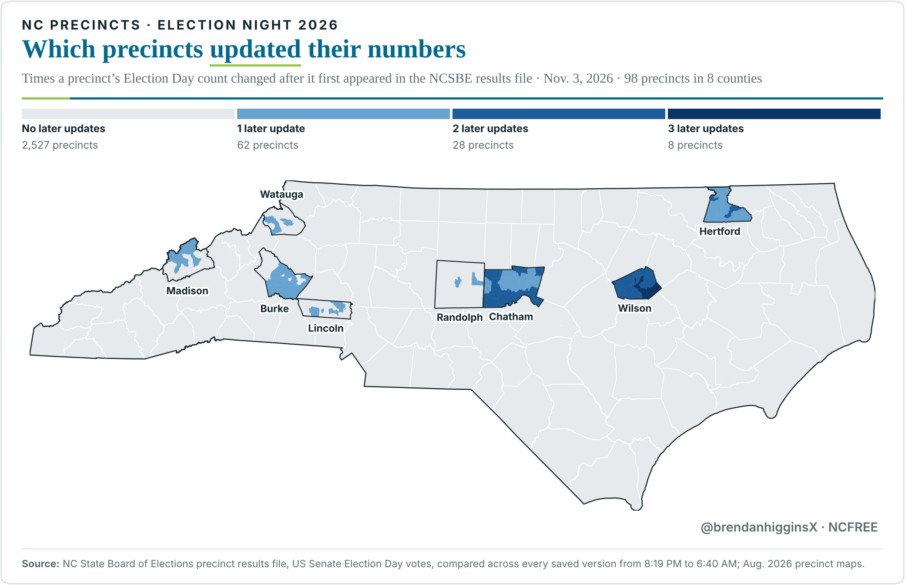

NCFREE members will receive our full report on the new General Assembly, including the bills to watch in 2027. Follow Brendan on X at@brendanhigginsX.

NCFREE by email

Get NCFREE research and updates in your inbox.

NCFREE membership

Put NCFREE research to work for your organization.

Members receive research, briefings and access tailored to their organization.

## More from NCFREE

← All news and analysis